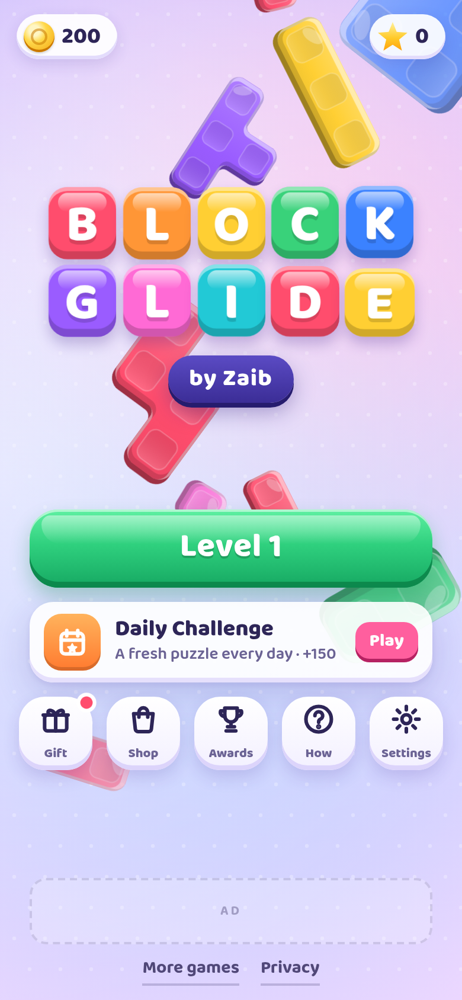
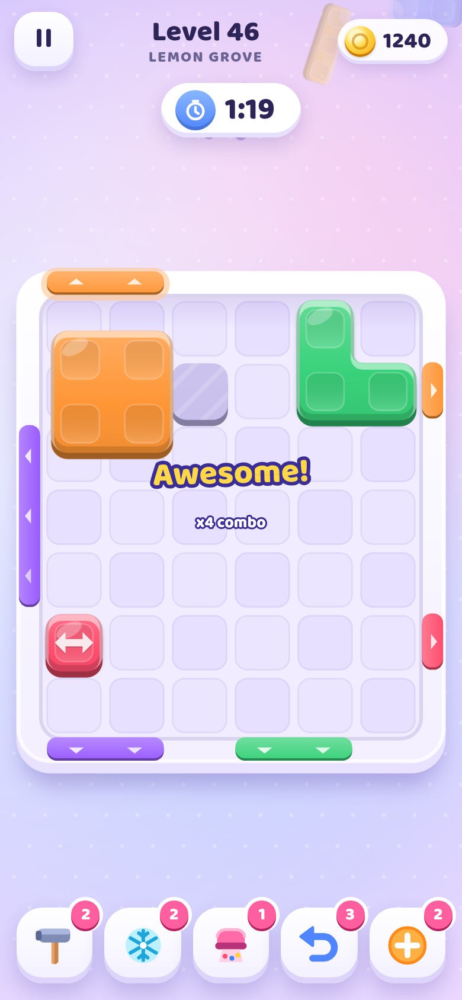
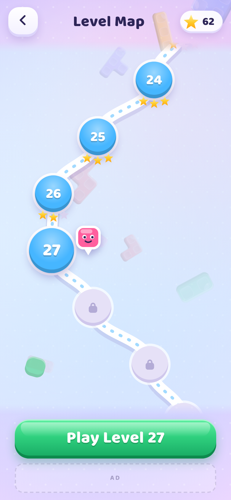
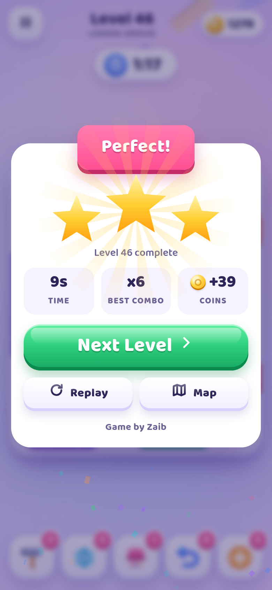

# Block Glide 🟥🟨🟦

**A cozy color block sliding puzzle for mobile browsers. Game by Zaib.**

▶ **Play:** https://zaibgames.com/block-glide/

| Title | Gameplay | Level map | Results |
|---|---|---|---|
|  |  |  |  |

Drag soft clay blocks around the board. When a block reaches a gate of the same color and fits the gate's width, it slides out. Clear every block before the timer or the move counter runs out.

## Features
- **160 hand-tuned, solver-checked levels** in 8 themed chapters (Candy Meadow, Frosty Peaks, Lemon Grove, Spin Studio, Rainbow Bay, Fizz Factory, Moon Garden, Star Palace). Each level was generated and then kept only if a solver bot could clear it within its limits. Difficulty rises steadily, and every 10th level is a marked "Hard" level.
- **New mechanics as you go:** timers, move limits, one-way arrow blocks, ice blocks that thaw as you clear others, two-color layered blocks, locks with key blocks, board stars to collect, rotating blocks (tap to spin), gates that shift color, and bomb blocks with a countdown.
- **Boosters:** Hammer (smash a block), Freeze (stops the timer for 12 s), Vacuum (removes one color), Undo, and Extra (+5 moves or +15 s).
- **Daily Challenge:** a new puzzle every day, built and solver-checked in your browser, with a streak counter. There is also a 7-day Daily Gift calendar, 14 achievements, coins and stars.
- **Shop:** 6 block skins (Soft Clay, Candy Gloss, Toy Bricks, Jelly, Block Buddies with blinking faces, Gemstone), 6 themes (Lilac Dream, Mint Breeze, Peach Fizz, Lagoon, Sakura, Starry Night) and boosters.
- **Polish:** soft 3D clay blocks with lighting and shadows. Dragging snaps to the grid, a ghost shows where the block will land, and blocks stretch back when they hit something. Exits whoosh out with particles, combos pop up as text, wins rain confetti, and stars pop in one by one. The early levels have animated hand hints, and each new mechanic gets an intro card. Music and sound effects are generated with WebAudio, and phones vibrate on key actions.
- **Accessibility:** optional color symbols on blocks and gates for color-blind play.
- **Tech:** the whole game is one self-contained HTML file with an embedded rounded font subset (Baloo 2, OFL). It is portrait-first but also works in landscape. It uses touch and mouse, blocks scroll and zoom, runs at 60 fps with automatic quality fallback, pauses when the tab is hidden and saves progress in localStorage. There are no ads, only an empty placeholder slot.

## Controls
| Action | Touch / mouse | Keyboard |
|---|---|---|
| Move a block | Drag it | – |
| Rotate a swirl block | Tap it | – |
| Boosters | Buttons at the bottom (right side in landscape) | 1–5, Z/U = undo |
| Pause / restart | ⏸ | Esc or P / R |

## Credits
Game, art, music and code by **Zaib**. All names, art and sounds are original.
